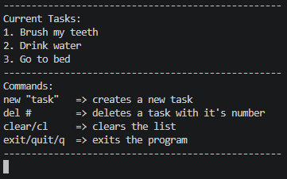

[](LICENSE) 

# rust-todolist

> A to-do program to keep track of your tasks made with Rust. 

This program lets you create a to-do list and modify it. You can add/remove tasks and clear tasks.



## Table of Contents

- [Features](#features)
- [Prerequisites](#prerequisites)
- [Installation](#installation)
- [Usage](#usage)
- [Tech Stack](#tech-stack)
- [License](#license)

## Features

- Add a task to the list
- Remove an existing task from the list
- Clear the to-do list

### Prerequisites

- rustup & cargo

### Installation

```bash
git clone https://github.com/zgndia/rust-todolist.git
cd rust-todolist
cargo build --release
```

### Usage

```bash
cargo run --release
```

## Tech Stack

- **Rust**

## License

This project is licensed under the MIT License — see the [LICENSE](LICENSE) file for details.

---

Built by **zgndia**
